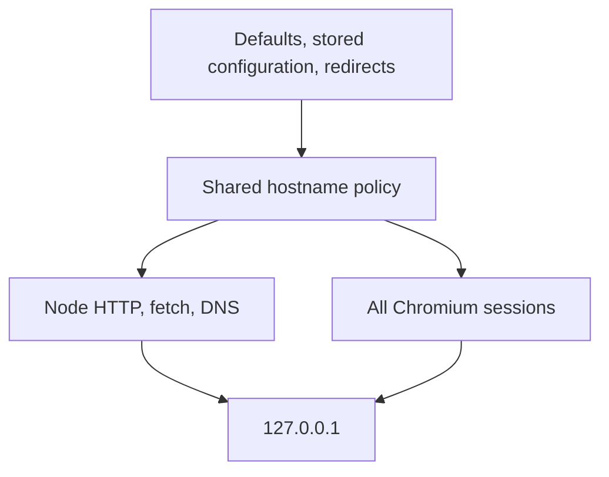

# Privacy fork contract

This fork removes product reporting and optional publication while preserving the coding agent.

- Custom model providers, proxies, certificates, API-key storage and existing permissions remain available. Zhipu/Z.ai destinations are the exception: every application-owned URL under `z.ai`, `bigmodel.cn`, `codegeex.cn`, `chatglm.cn`, `zcode.ai`, `zhipuai.cn`, `zhipuai.com`, `zhipu.cn`, or `zhipu.ai`, and the specific `zhipu-ai.feishu.cn` tenant, is mapped to `127.0.0.1`. Matching includes subdomains, case and trailing-dot normalization, but not unrelated lookalike suffixes. Other Feishu tenants and unrelated providers are unchanged.
- Shipped runtime URL literals, environment examples, provider endpoints, resource links and bundled skill URLs use loopback. Historical settings, environment overrides, runtime responses, HTTP redirects and WebSocket targets are also filtered at the Node and Electron network boundaries. Scheme, port, path and query are retained; loopback mapping cannot send the original vendor hostname to a configured proxy. HTTP redirect method/body rules, cross-origin credential stripping, abort signals and a bounded redirect count are retained. Automatic model gateway rerouting is removed so unrelated localhost providers cannot inherit a vendor route.
- Node process network installation owns HTTP(S), fetch and DNS enforcement; Electron's session interceptor owns Chromium requests and coexists with existing request observers and plugin sandbox listeners. There is one shared pure hostname/URL policy, with no user setting or environment opt-out. Requests are mapped before proxy selection or dispatch, and redirects re-enter that boundary. This is application enforcement, not an OS firewall for arbitrary terminal commands, independent programs, child-process tools or downloaded third-party code.
- ARMS desktop/browser instrumentation, service event reporting, CLI OTLP traces/metrics, renderer action traces and TTFT exports are unavailable. Old settings, environment variables, build defines and injected telemetry owners cannot enable them. Disabled entry points do not initialize exporters, read reporting identities, serialize batches or schedule export retries.
- Automatic application updates, manual/forced updater network entry points and startup force-update checks and background vendor model-registry refreshes are disabled. Existing settings cannot re-enable them. Installing a new version is an explicit action outside the application.
- Conversation cloud publication and support-feedback uploads are disabled before token access, file reads or network transmission. Model attachments, file transfer to a selected workspace and user-requested tool networking remain normal functionality.
- Local diagnostic logs and local session storage remain functional. No automatic upload of those files is available through the removed features.
- Desktop packaging must not inject or require removed reporting SDKs or OTLP exporters.

Owners: reporting adapters own inert compatibility interfaces; updater owns its disabled state; publication adapters reject optional upload capabilities with a stable error. The shared vendor network policy owns domain matching; Node and Chromium adapters enforce it without changing tool admission or maintaining mirrored configuration.

Acceptance: test disabled reporting despite injected endpoints/exporters/owners, blocked optional uploads before authentication/file access, disabled updater despite enabled options, vendor matching and lookalikes, legacy/runtime URLs, direct and proxied requests, redirect chains, POST bodies, abort behavior, all Chromium sessions and listener replacement. Local HTTP integration tests must prove a vendor URL reaches loopback without vendor DNS. Test that non-vendor models and their proxy settings are preserved, and localhost model requests are never rerouted to a vendor gateway. Existing telemetry tests must describe the fork's disabled contract; pure local telemetry data-format helpers may retain their original tests.

Scope: application-owned automatic uploads and reporting. A model chosen by the user receives prompts and attachments; terminal commands and configured extensions retain their existing network capabilities. This is not an OS network sandbox or a claim that every dependency is vulnerability-free.
